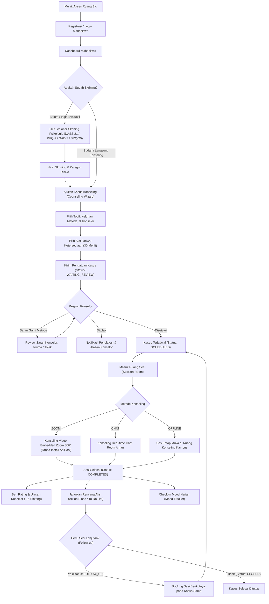
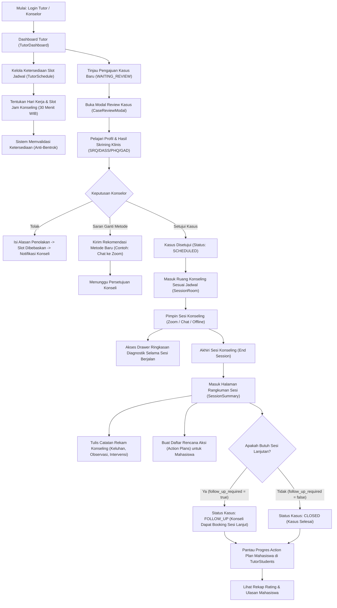
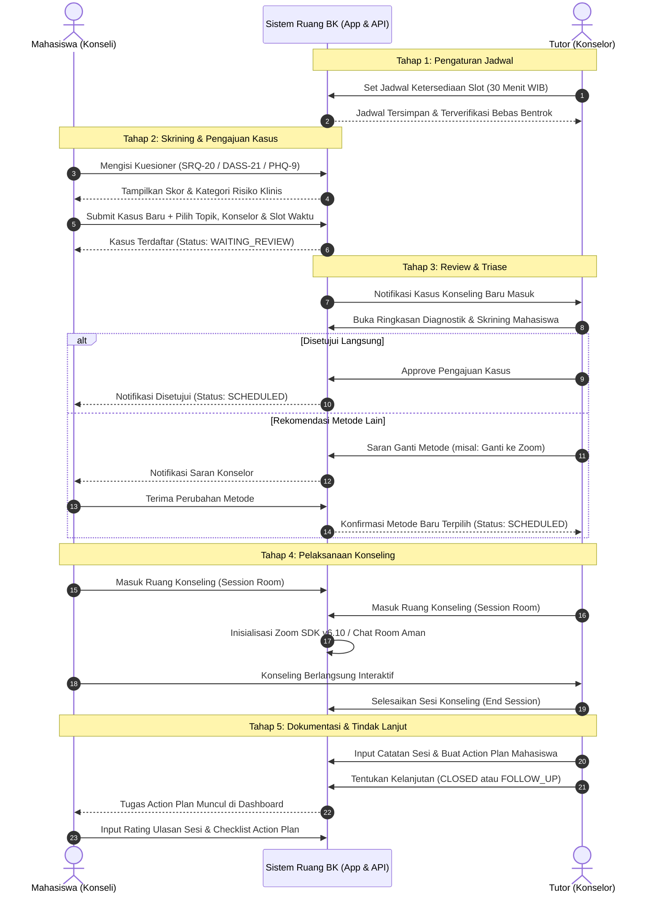

# Bahan Presentasi: Alur Penggunaan Aplikasi Ruang BK (BK Online)
## Panduan Alur Kerja Mahasiswa (Konseli) & Tutor (Konselor)

Dokumen ini disusun sebagai panduan komprehensif dan materi presentasi untuk menjelaskan alur kerja (*user journey*), titik interaksi sistem, dan fitur unggulan dari platform **Ruang BK (BK Online)** bagi dua pengguna utama: **Mahasiswa (Konseli)** dan **Tutor (Konselor)**.

---

## 1. Ringkasan Eksekutif & Gambaran Sistem

Platform **Ruang BK** adalah sistem layanan bimbingan konseling digital terintegrasi yang dirancang untuk mempermudah civitas akademika dalam mengakses layanan kesehatan mental dan konseling akademik/pribadi secara rahasia, terstruktur, dan akuntabel.

### Karakteristik Utama Platform:
1. **Multi-Metode Fleksibel:** Konseling dapat dilakukan melalui video konferensi langsung (*Embedded Zoom SDK v6.10.0*), *Real-Time Live Chat*, maupun sesi tatap muka luring (*Offline*).
2. **Skrining Klinis Otomatis:** Dilengkapi 4 instrumen psikometrik baku (SRQ-20, DASS-21, PHQ-9, GAD-7) dengan penilaian risiko otomatis untuk membantu konselor melakukan triase.
3. **Akuntabilitas & Pendampingan Berkelanjutan:** Dilengkapi fitur *Action Plan* (tugas perilaku terapeutik pasca-sesi) dan *Daily Mood Tracker* untuk memantau perkembangan emosi konseli secara berkesinambungan.
4. **Sistem Penjadwalan Terintegrasi:** Berbasis slot 30 menit Waktu Indonesia Barat (WIB) dengan validasi anti-bentrok slot (*collision prevention*).

---

## 2. Alur Penggunaan Mahasiswa (Konseli Journey)

Alur mahasiswa dirancang secara *user-friendly*, empatik, dan bebas hambatan (*frictionless*) guna mendorong keterbukaan dan kenyamanan konseli sejak awal pendaftaran hingga evaluasi pasca-sesi.

### 2.1 Diagram Alur Mahasiswa (Flowchart)

---

### 2.2 Tahapan Detail Perjalanan Mahasiswa

#### Tahap 1: Registrasi & Autentikasi Mahasiswa
- **Aksi Pengguna:** Membuka halaman pendaftaran [RegisterStudent.jsx](file:///c:/Users/Saifudin/.gemini/antigravity-ide/scratch/bk-online/frontend/src/pages/auth/RegisterStudent.jsx), memasukkan data identitas (NIM, Nama Lengkap, Fakultas/Jurusan, Email Kampus, Kata Sandi).
- **Logika Sistem:** Validasi keunikan NIM dan email. Sistem menerbitkan token sesi aman (*Laravel Sanctum*).

#### Tahap 2: Skrining Mandiri Psikologis
- **Aksi Pengguna:** Mengakses menu Kuesioner [QuestionnaireRunner.jsx](file:///c:/Users/Saifudin/.gemini/antigravity-ide/scratch/bk-online/frontend/src/pages/questionnaire/QuestionnaireRunner.jsx).
- **Instrumen Tersedia:**
  1. **SRQ-20:** Skrining gangguan psikologis umum & kesehatan jiwa dasar.
  2. **DASS-21:** Penilaian tingkat Depresi, Kecemasan (*Anxiety*), dan Stres.
  3. **PHQ-9:** Evaluasi mendalam derajat keparahan depresi.
  4. **GAD-7:** Evaluasi gangguan kecemasan menyeluruh.
- **Hasil:** Skor otomatis diklasifikasikan (Normal, Ringan, Sedang, Berat, Ekstrem) dan langsung dihubungkan ke rekam medis konseli secara privat.

#### Tahap 3: Pengajuan Kasus Konseling (Counseling Wizard)
- **Aksi Pengguna:** Membuka menu pengajuan konseling [CounselingWizard.jsx](file:///c:/Users/Saifudin/.gemini/antigravity-ide/scratch/bk-online/frontend/src/pages/counseling/CounselingWizard.jsx).
- **Langkah-langkah Wizard:**
  1. **Pemilihan Topik:** Akademik, Karir, Hubungan Sosial, Masalah Keluarga, Kecemasan Pribadi, dll.
  2. **Pemilihan Konselor:** Melihat profil konselor, spesialisasi, latar belakang, dan rating ulasan [CounselorsByTopicPage.jsx](file:///c:/Users/Saifudin/.gemini/antigravity-ide/scratch/bk-online/frontend/src/pages/counseling/CounselorsByTopicPage.jsx).
  3. **Pemilihan Metode:** Memilih antara `ZOOM`, `CHAT`, atau `OFFLINE`.
  4. **Deskripsi Permasalahan:** Menuliskan keluhan atau hal yang ingin dikonsultasikan.
  5. **Pemilihan Slot Waktu:** Memilih tanggal dan jam ketersediaan konselor yang aktif (blok 30 menit).
- **Sistem Guard:** *Active Case Guard* memastikan mahasiswa menyelesaikan kasus aktif sebelum membuka kasus baru untuk menjaga efektivitas konseling.

#### Tahap 4: Penjadwalan & Konfirmasi Kasus
- Status awal kasus: `WAITING_REVIEW`.
- Jika konselor menyetujui: Status berpindah ke `SCHEDULED`.
- Jika konselor menyarankan metode lain (misal: kasus berat dari Chat dialihkan ke Zoom): Mahasiswa menerima pemberitahuan di [StudentDashboard.jsx](file:///c:/Users/Saifudin/.gemini/antigravity-ide/scratch/bk-online/frontend/src/pages/student/StudentDashboard.jsx) untuk menyetujui atau menolak rekomendasi konselor.

#### Tahap 5: Pelaksanaan Sesi Konseling (Session Room)
- Mahasiswa membuka ruang sesi [SessionRoom.jsx](file:///c:/Users/Saifudin/.gemini/antigravity-ide/scratch/bk-online/frontend/src/pages/counseling/SessionRoom.jsx) pada jadwal yang telah ditetapkan:
  - **Metode ZOOM:** Video call langsung berjalan di dalam browser menggunakan *Zoom Meeting SDK v6.10.0 Component View* tanpa mengharuskan instalasi aplikasi Zoom Desktop, dilengkapi tombol alternatif (*Launch External Zoom*) bila perangkat membutuhkan.
  - **Metode CHAT:** Ruang obrolan real-time privat dengan penanda waktu (*timestamp*), pembatas pesan, dan riwayat terenkripsi.
  - **Metode OFFLINE:** Tampilan detail lokasi ruang bimbingan fisik, denah, dan nomor kontak petugas konseling kampus.

#### Tahap 6: Rencana Aksi & Tindak Lanjut Mandiri
- Pasca-sesi, konselor merumuskan tugas pemulihan yang muncul di halaman [ActionPlansPage.jsx](file:///c:/Users/Saifudin/.gemini/antigravity-ide/scratch/bk-online/frontend/src/pages/student/ActionPlansPage.jsx).
- Mahasiswa mencentang daftar tindakan yang telah selesai dikerjakan (contoh: *Latihan pernapasan 10 menit*, *Membuat jadwal belajar mingguan*).

#### Tahap 7: Evaluasi & Mood Tracker
- **Umpan Balik:** Mahasiswa mengisi ulasan dan bintang (1-5) melalui [SessionFeedbackModal.jsx](file:///c:/Users/Saifudin/.gemini/antigravity-ide/scratch/bk-online/frontend/src/components/counseling/SessionFeedbackModal.jsx).
- **Mood Tracker:** Mahasiswa dapat mencatat suasana hati harian di dashboard untuk melihat grafik perkembangan emosi dari waktu ke waktu.

---

### 2.3 Poin Bicara Presenter (Talking Points - Slide Mahasiswa)

> *"Bagi mahasiswa, platform ini menghilangkan rasa cemas dan ketakutan akan stigma. Mahasiswa tidak perlu mengantre secara fisik atau merasa canggung. Mulai dari skrining kesehatan mental mandiri yang hasilnya langsung keluar secara otomatis, hingga memilih konselor dan metode yang paling nyaman bagi mereka—apakah itu via teks (chat) bagi yang pemalu, video conference Zoom langsung di browser tanpa perlu download aplikasi tambahan, atau tatap muka di kampus. Setelah sesi selesai, mahasiswa dibekali 'Action Plan' konkret dan fitur pemantau mood harian sehingga proses pemulihan mental terus terpandu."*

---

## 3. Alur Penggunaan Tutor / Konselor (Counselor Journey)

Alur kerja konselor berfokus pada manajemen waktu yang efisien, akses cepat terhadap data klinis konseli sebelum sesi, serta pencatatan rekam konseling yang aman dan terstruktur.

### 3.1 Diagram Alur Tutor (Flowchart)

---

### 3.2 Tahapan Detail Perjalanan Tutor / Konselor

#### Tahap 1: Akses Dashboard & Pengaturan Ketersediaan (Slot 30 Menit)
- **Halaman Utama:** [TutorDashboard.jsx](file:///c:/Users/Saifudin/.gemini/antigravity-ide/scratch/bk-online/frontend/src/pages/tutor/TutorDashboard.jsx). Menampilkan statistik kasus aktif, sesi hari ini, total konseli yang didampingi, dan skor kepuasan rata-rata.
- **Pengaturan Jadwal:** Konselor membuka [TutorSchedule.jsx](file:///c:/Users/Saifudin/.gemini/antigravity-ide/scratch/bk-online/frontend/src/pages/tutor/TutorSchedule.jsx) untuk menentukan hari kerja dan jam ketersediaan dalam interval 30 menit.
- **Proteksi Anti-Bentrok:** Sistem backend secara otomatis mencegah bentrok slot antar sesi konseling dan menyelaraskan zona waktu (WIB / UTC).

#### Tahap 2: Triase Kasus & Pemeriksaan Diagnostik
- Saat pengajuan baru masuk (*Status: WAITING_REVIEW*), konselor membuka [CaseReviewModal.jsx](file:///c:/Users/Saifudin/.gemini/antigravity-ide/scratch/bk-online/frontend/src/components/counseling/CaseReviewModal.jsx).
- **Analisis Pra-Sesi:** Konselor dapat memeriksa rincian hasil skrining mahasiswa melalui [CounseleeDiagnosticModal.jsx](file:///c:/Users/Saifudin/.gemini/antigravity-ide/scratch/bk-online/frontend/src/components/counseling/CounseleeDiagnosticModal.jsx):
  - Kategori tingkat stres, kecemasan, atau depresi.
  - Peringatan krisis (*crisis alert*) jika terdeteksi indikasi kedaruratan psikologis.
- **Tiga Pilihan Aksi:**
  1. **Setujui (`approve`):** Kasus resmi dijadwalkan (*SCHEDULED*).
  2. **Tolak (`reject`):** Memberikan keterangan alasan pembatalan; slot jadwal langsung otomatis dibebaskan kembali.
  3. **Saran Ganti Metode (`suggest-method`):** Jika konselor merasa keluhan mahasiswa lebih tepat ditangani dengan tatap muka atau video Zoom daripada chat tertulis.

#### Tahap 3: Pelaksanaan Sesi Konseling Interaktif
- Konselor memasuki ruang sesi [SessionRoom.jsx](file:///c:/Users/Saifudin/.gemini/antigravity-ide/scratch/bk-online/frontend/src/pages/counseling/SessionRoom.jsx).
- **Fitur Ruang Sesi:**
  - Timer durasi sesi aktif.
  - Tombol pintas untuk membuka data diagnostik konseli (*side-drawer*) tanpa meninggalkan sesi.
  - Kontrol sesi untuk mengakhiri konseling secara resmi saat waktu selesai.

#### Tahap 4: Dokumentasi SOAP & Rencana Aksi (Session Summary)
- Begitu sesi diakhiri, konselor dialihkan ke [SessionSummary.jsx](file:///c:/Users/Saifudin/.gemini/antigravity-ide/scratch/bk-online/frontend/src/pages/counseling/SessionSummary.jsx).
- **Pencatatan Rekam Medis Konseling:**
  - Masalah teridentifikasi (*Identified issues*).
  - Observasi klinis & intervensi yang diberikan.
- **Pemberian Action Plan:** Konselor menambahkan butir tugas konkret untuk konseli beserta tanggal target penyelesaian.
- **Keputusan Penutupan Kasus:**
  - Jika memerlukan sesi pendalaman: Menandai `follow_up_required = true` -> status kasus menjadi `FOLLOW_UP`.
  - Jika masalah terselesaikan: Menandai `follow_up_required = false` -> status kasus menjadi `CLOSED`.

#### Tahap 5: Pemantauan Pasca-Sesi (Monitoring)
- Melalui menu [TutorStudents.jsx](file:///c:/Users/Saifudin/.gemini/antigravity-ide/scratch/bk-online/frontend/src/pages/tutor/TutorStudents.jsx), konselor dapat:
  - Melihat riwayat konseli terdahulu.
  - Memantau apakah konseli mencentang *Action Plan* yang ditugaskan.
  - Membaca umpan balik dan testimoni anonim dari konseli untuk evaluasi diri.

---

### 3.3 Poin Bicara Presenter (Talking Points - Slide Tutor)

> *"Bagi konselor atau bapak/ibu dosen pembimbing konseling, platform ini memberikan kendali penuh dan efisiensi kerja tinggi. Konselor tidak lagi dibebani penjadwalan manual yang rentan bentrok jadwal. Konselor memiliki data awal yang kaya sebelum sesi dimulai—karena hasil tes DASS-21 atau PHQ-9 mahasiswa sudah terbaca jelas di sistem. Selain itu, proses dokumentasi sesi (case notes) terintegrasi langsung dengan penugasan rencana aksi mahasiswa, sehingga proses intervensi psikologis terukur dan memiliki bukti rekam jejak yang jelas."*

---

## 4. Diagram Interaksi Antar-Peran (Sequence Diagram)

Diagram berikut memperlihatkan bagaimana mahasiswa, tutor/konselor, dan sistem backend saling berinteraksi secara sinkron:

---

## 5. Ringkasan Fitur Unggulan untuk Bahan Paparan (Key Highlights)

Tabel berikut dapat dijadikan matriks keunggulan dalam slide presentasi penutup:

| Fitur Utama | Manfaat bagi Mahasiswa | Manfaat bagi Tutor / Konselor | Keunggulan Teknis Sistem |
| :--- | :--- | :--- | :--- |
| **Pilihan 3 Metode Konseling** | Fleksibilitas sesuai kenyamanan mental (Zoom, Chat, Tatap Muka). | Kemampuan menyesuaikan modalitas intervensi sesuai tingkat keparahan kasus. | Integrasi *Zoom Meeting SDK v6.10.0 Component View* (tanpa install app luar). |
| **Skrining Klinis Baku** | Deteksi dini mandiri tanpa takut dihakimi. | Data klinis awal siap pakai sebelum sesi dimulai (efisiensi waktu triase). | Algoritma skoring otomatis untuk SRQ-20, DASS-21, PHQ-9, dan GAD-7. |
| **Sistem Slot Waktu 30 Menit** | Kepastian jadwal dan transparansi ketersediaan konselor. | Kontrol jam kerja konseling yang tertib dan anti-tumpang tindih. | *Conflict Prevention Engine* berbasis UTC & penyesuaian lokal WIB. |
| **Action Plan Terapeutik** | Langkah nyata dan terarah pasca-konseling agar tidak bingung. | Pemantauan kepatuhan konseli terhadap arahan terapeutik. | Pelacakan progres *checklist* interaktif di dashboard. |
| **Keamanan & Kerahasiaan** | Anonimitas terjamin dan rekam konseling aman. | Rekam jejak kasus tersusun rapi sesuai etika konseling. | Autentikasi berbasis *Laravel Sanctum Token* & *Role-Based Access Control (RBAC)*. |

---

## 6. Contoh Panduan Presentasi Singkat (Pitching Script)

### Pembuka (1 Menit):
> *"Selamat pagi/siang Bapak, Ibu, dan rekan-rekan sekalian. Hari ini kami memperkenalkan **Ruang BK**, sebuah ekosistem bimbingan konseling digital terpadu yang menjembatani kebutuhan mahasiswa akan layanan kesehatan mental yang ramah, aman, dan mudah dijangkau dengan kebutuhan konselor akan manajemen kasus yang rapi dan terukur."*

### Inti Paparan (2-3 Menit):
> *"Dari sisi mahasiswa, perjalanan dimulai dari kemudahan melakukan asesmen mandiri dengan instrumen baku seperti DASS-21 dan PHQ-9. Mahasiswa dapat memilih konselor yang sesuai dengan masalahnya serta memilih metode yang paling membuat mereka nyaman—termasuk telekonseling Zoom yang tersemat langsung di halaman web kami tanpa kerumitan mengunduh aplikasi lain.*
> 
> *Dari sisi konselor atau tutor, aplikasi ini menyelesaikan masalah penjadwalan manual dan 'buta informasi'. Konselor menerima ringkasan kondisi psikologis mahasiswa sebelum tatap muka dimulai. Setelah sesi berakhir, konselor dapat menyusun Action Plan terukur yang dapat dipantau perkembangannya secara berkelanjutan."*

### Penutup:
> *"Dengan sistem ini, bimbingan konseling kampus bertransformasi dari pendekatan reaktif menjadi pendampingan yang proaktif, modern, dan terdokumentasi dengan standar kerahasiaan tertinggi. Terima kasih."*
